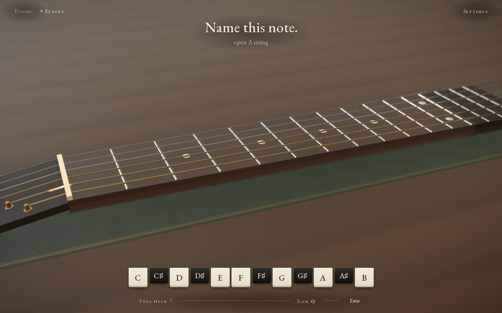
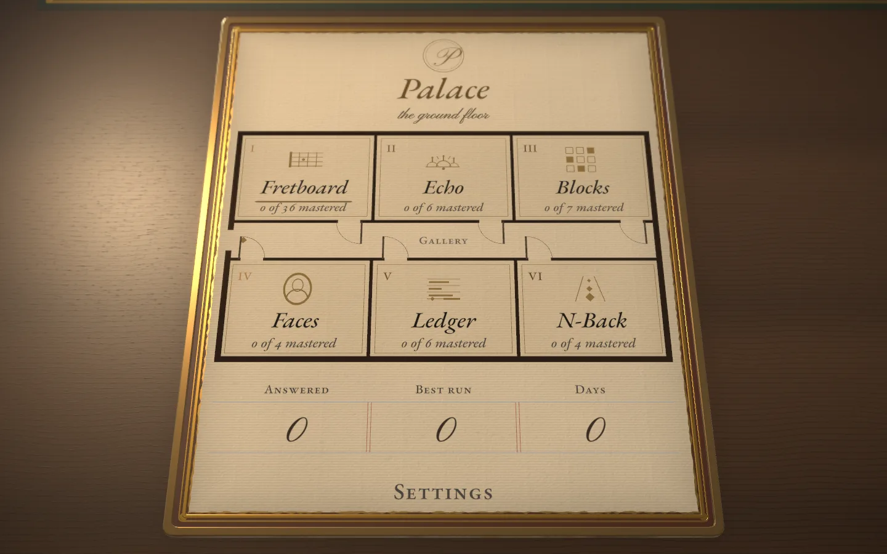
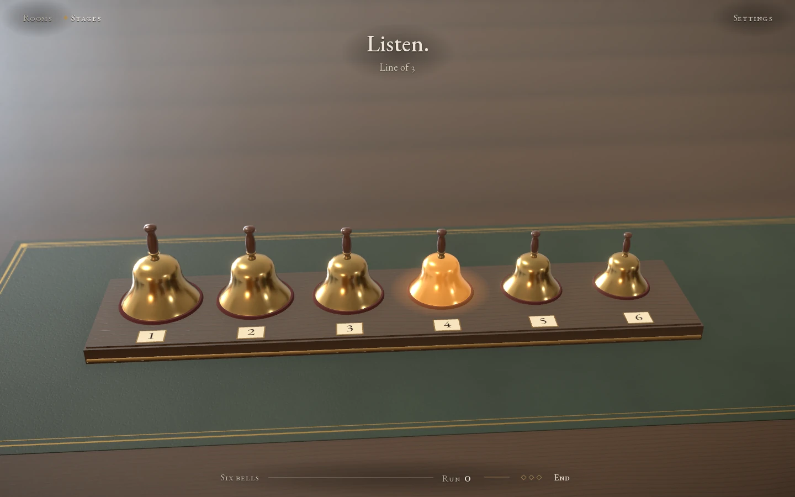
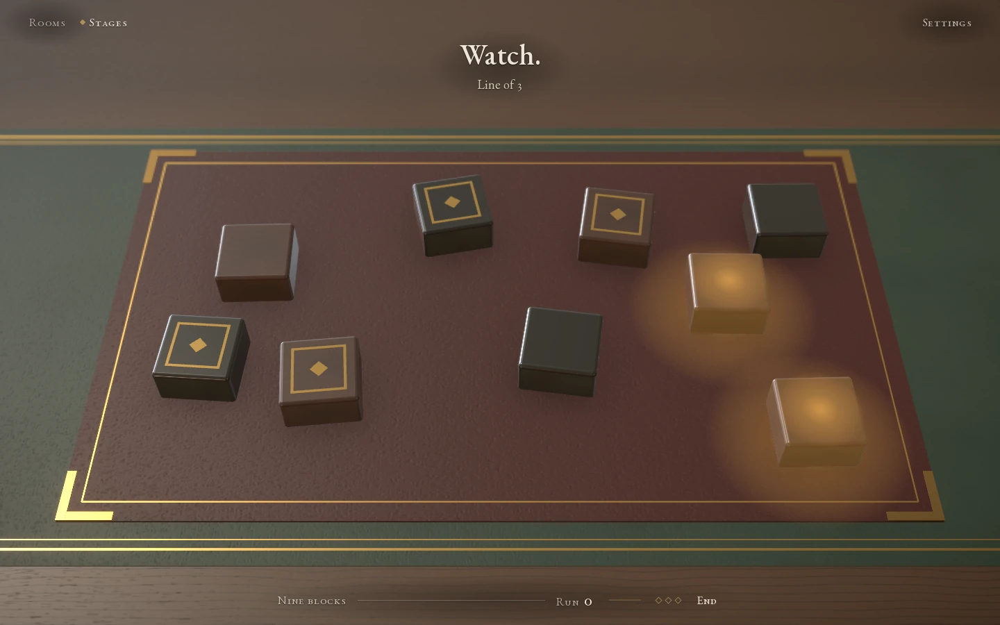
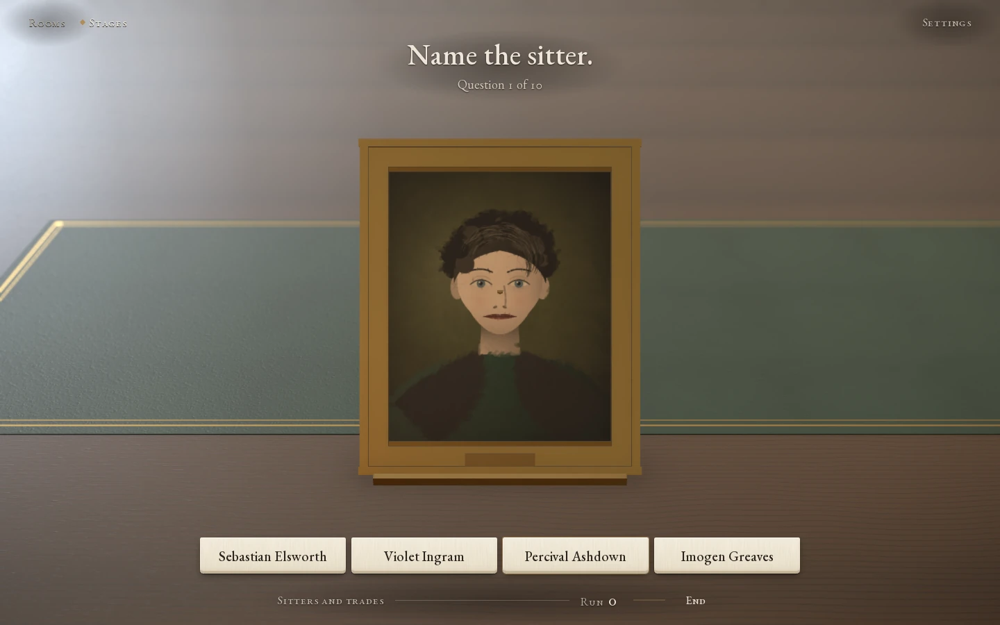
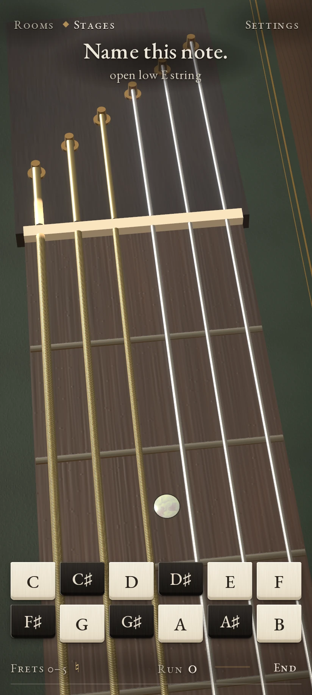
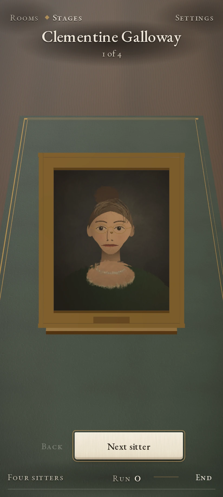
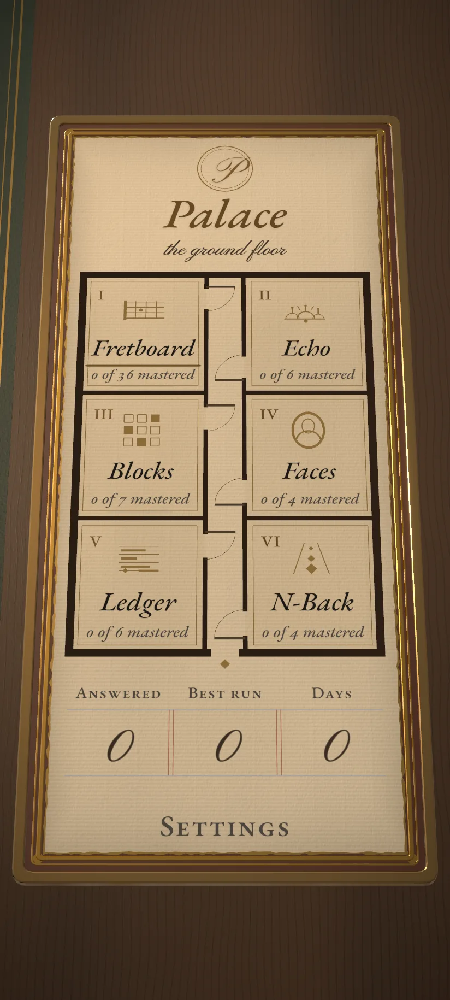

<p align="center">
  <a href="https://aieatassam.github.io/palace/"></a>
</p>

<h1 align="center">Palace</h1>

<p align="center"><b>A memory palace in rosewood, brass and leather.</b><br>
Four rooms, four kinds of memory, one walnut desk.</p>

<p align="center"><a href="https://aieatassam.github.io/palace/"><b>▶&nbsp;&nbsp;Play in your browser</b></a><br>
<sub>Free. No account, no install. Phone or desktop.</sub></p>

---

You sit at a walnut desk with a gilt-framed card of rooms in front of you. Pick a room, pick a stage, and play a short sitting. Five right in a row and the room writes *Bravo* over the desk in copperplate and throws up gold leaf. Master a stage and an oxblood wax seal lands beside your work.

<p align="center"></p>

## The rooms

### I · Fretboard
Name every note on a guitar neck. Brass marks a place; you name its note, find every place a note sounds, or reach its octave two strings over. Get it right and the string plucks at its true pitch. Thirty-two stages run in two books, naturals then sharps and flats, from a single string to the full twelve frets. Spaced repetition picks the next question.

### II · Echo
A row of brass hand bells rings a line. You ring it back. A clean line grows by one stroke, a slip shrinks it by one, and three slips close the page. Later stages ring last first, quicken the beat, or strike two bells at once.

<p align="center"></p>

### III · Blocks
Rosewood and ebony blocks lie scattered on an oxblood blotter. A line of them lights; you tap it back in order. Boards run from nine blocks to sixteen, and two stages rearrange the board before each line.

<p align="center"></p>

### IV · Faces
Meet a cast of sitters, each an oil portrait in a gilt frame with a name and sometimes a trade. Then name them. Questions come three ways: a portrait and four names, a name and four portraits, or a portrait and four trades. One stage covers the frames for thirty seconds before it asks. Miss a face and it comes back before the sitting ends.

<p align="center"></p>

<p align="center">
  
  
  
</p>

**In the workshop:** Ledger (long numbers) and N-Back (a corridor of repeats). Their plates already sit on the card; open one to see what it will train.

## Rewards

- **Flourish.** Five right in a row, in any room, writes a word in Pinyon Script: *Bravo*, then *Splendid*, *Superb*, *Bravissimo*. In Echo and Blocks a clean line counts as one.
- **Gold leaf.** The same milestone throws torn gold scraps up from the place you answered. They flash as they turn and drift down.
- **Chime.** A brass chime strikes at each milestone, a step higher on a pentatonic scale each time the run goes on.
- **Combo meter.** A slim brass bar beside your run fills toward the next milestone.
- **Wax seal.** Cross a stage's mastery bar and an oxblood seal drops onto a bare patch of desk and squashes under the press. A rolled chord sounds and a *Mastered* caption appears.
- **Daily record.** The foot of the card keeps today's answers, your best run and your days at the desk. Skip a day and the numeral cools to stone. The count stays.

Every stage in every room is open from your first visit. Choose where to start.

Turn on reduce motion (in your OS or the settings sheet) and the gold leaf stays away and the seal sets down without travel. A screen reader hears each reward once. You can play by keyboard: arrow keys and Enter on the neck and the blotter, number keys for the bells and the Faces choices.

---

## Under the desk

**Stack.** React 19, TypeScript, Vite, three.js through react-three-fiber and drei, Zustand. Web Audio makes every sound: a Karplus–Strong pluck for the strings, additive synthesis for bells and chimes. Type is EB Garamond, self-hosted.

**Layout.** `src/modes/catalog.ts` lists the six rooms as data and `src/modes/registry.tsx` registers the four that are built. Fretboard lives in `src/game` and `src/three`; the others in `src/echo`, `src/blocks` and `src/faces`. Shared rewards sit in `src/rewards`, and the spaced-repetition scheduler (an SM-2 variant with in-session learning steps) in `src/game/srs.ts`.

```sh
npm install
npm run dev        # Vite dev server
npm run typecheck  # tsc --noEmit
npm run lint       # ESLint
npm test           # Vitest unit tests
npm run build      # type-check, then build to dist/
npm run e2e        # Playwright: desktop 960×600 and phone 412×915
```

**Render paths.** The full path has physical materials, an HDRI reading room, bloom, vignette and (on desktop) depth of field. The lite path runs at DPR 1 with standard materials, small textures and no post-processing. The app picks lite under automation (`navigator.webdriver`) or with `?lite`. `?quality=full` forces the full path; add `?capture` to hold it at its top tier and slow the animations for stills.

**Tests.** Playwright builds the app and serves it with `vite preview`. Headless WebGL renders on the CPU, so e2e runs the lite path. To use a local Chrome: `CHROME_PATH=/usr/bin/google-chrome npm run e2e`. `window.__palace` exposes hooks for tests and devtools, among them `hub()` and `enter(stageId)` on `fretboard`, `echo`, `blocks` and `faces`.

**CI.** `.github/workflows/ci.yml` runs typecheck, lint, unit tests and build in one job and splits e2e across four sharded runners, one worker each. `deploy.yml` publishes `dist/` to GitHub Pages on each push to `main`.

Design notes: [`CONCEPT.md`](./CONCEPT.md) and [`docs/ux/redesign.md`](./docs/ux/redesign.md).
